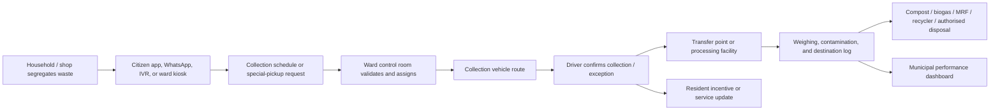

# Municipal Waste Operations Platform for India

## Working title

**WasteFlow India** — a nationally interoperable, municipality-operated platform for reliable collection, source segregation, routing, processing visibility, and citizen issue resolution.

> This is a concept brief, not yet a final solution. It deliberately narrows “centralized waste management for all India” into a practical model: each Urban Local Body (ULB) runs its own operations, while using a common platform, data model, and workflow.

## 1. The problem

India does not have only a “garbage collection” problem. It has a **last-mile coordination and accountability problem** across households, commercial establishments, collection crews, contractors, municipal supervisors, processing facilities, recyclers, and citizens.

A resident may segregate waste but miss the vehicle. A collector may pick up mixed waste because the route is late or capacity is full. A ward supervisor may not know whether a complaint is genuine, whether a vehicle actually reached an area, or where a load ultimately went. A Material Recovery Facility (MRF) may receive a mixed or contaminated load that is much harder to recycle. A municipal corporation may have high-level dashboard data but lack a usable operating view of what failed today, where, why, and who should act.

The core problem statement is:

> When a household, shop, or institution generates waste, it often cannot reliably hand over correctly segregated waste through a visible, accountable collection workflow. This contaminates recyclable material, increases collection and processing cost, creates missed-pickup complaints, and makes it harder for a municipality to improve service ward by ward.

This is especially relevant in Indian cities because waste operations are managed locally by many ULBs, often through a mix of municipal teams, contractors, informal waste workers, facilities, and state-level systems.

## 2. Why this matters at national scale

According to a January 2026 Government of India update based on state/UT entries in the Swachhatam portal:

| Metric | Reported value |
|---|---:|
| Municipal solid waste generated in urban India | 162,162 tonnes/day |
| Municipal solid waste processed | 131,837 tonnes/day |
| Difference not reported as processed | about 30,325 tonnes/day |

Source: [Ministry of Housing and Urban Affairs / PIB, January 2026](https://www.pib.gov.in/PressReleaseIframePage.aspx?PRID=2220565&lang=2&reg=48).

The 30,325-tonne figure is a **difference between reported generation and processing**, not proof that all of that waste is uncollected or illegally dumped. It is still a useful indicator of the scale of the material-flow and processing gap.

India has made significant progress. The Swachh Bharat Mission–Urban Garbage Free City 2024–25 dashboard reports:

| Operational measure | Current coverage |
|---|---:|
| Wards with more than 90% door-to-door collection | 60,478 |
| Wards with more than 90% source segregation | 39,648 |
| ULBs resolving at least 90% of solid-waste grievances | 3,454 |
| ULBs processing at least 50% of wet waste | 1,325 |
| ULBs processing at least 50% of dry waste | 1,455 |

Source: [SBM-U Garbage Free City 2024–25 dashboard](https://stagingwebsite.sbmurban.org/gfc-result-dashboard-2024-25).

This means the opportunity is not “invent waste management from zero.” The opportunity is to help cities close the remaining gap with better day-to-day execution, traceability, resident participation, and facility-level visibility.

## 3. The India-specific insight

The national layer should provide common standards and interoperability. It should **not** centrally control every collection vehicle in India.

Each city differs in:

- ward boundaries, collection routes, waste volumes, facilities, and contractors;
- local-language needs;
- pickup schedules;
- municipal bylaws and fines;
- available composting, biogas, MRF, recycling, landfill, e-waste, and C&D-waste facilities;
- staffing and GPS/vehicle technology already in place.

So the right product model is:

```text
One shared platform and data standard
        ↓
Separate, configurable tenant for each municipal corporation
        ↓
Ward-level operations managed by the local city team
        ↓
Shared national benchmarking only with city approval and anonymised aggregates
```

The municipal corporation is the customer and operational owner. Residents, collectors, supervisors, contractors, processors, and recyclers use role-specific interfaces.

## 4. The actual user problems

### 4.1 Household resident

**Moment:** The collection vehicle has not arrived, or the resident is unsure whether an item goes into wet, dry, sanitary, hazardous, e-waste, or C&D waste.

**Current failure:** The resident has no trusted, local-language answer, cannot see the next collection window, and may not know whether a complaint was received or acted on.

**Cost:** Mixed waste, missed collection, littering, repeated calls/visits, and low trust in municipal service.

### 4.2 Commercial establishment or bulk waste generator

**Moment:** A restaurant, market, housing society, school, office, or event generates an unusually high volume of waste.

**Current failure:** Regular routes may not have enough capacity, and special pickup, proof of handover, compliance records, and source-segregation guidance are fragmented.

**Cost:** Overflow, contamination, penalties, lost recyclable value, and operational disruption.

### 4.3 Collection worker / Safai Mitra

**Moment:** A worker begins a route, finds mixed waste, faces an overflow point, or reaches a household that reports a missed collection.

**Current failure:** The worker may not have a simple route, verified exception list, load-capacity view, or a safe way to log a completed or failed pickup.

**Cost:** Longer routes, conflict with residents, mixed loads, low productivity, and weak accountability.

### 4.4 Ward supervisor / municipal control room

**Moment:** Multiple complaints arrive, a vehicle is late, a contractor claims completion, or a collection point overflows.

**Current failure:** Information is scattered across calls, WhatsApp, paper registers, GPS tools, and contractor reports. Supervisors cannot quickly distinguish a true service failure from a duplicate or already-resolved complaint.

**Cost:** Slow complaint closure, poor deployment decisions, and limited visibility into contractor performance.

### 4.5 MRF, composting, biogas, or recycling operator

**Moment:** A load reaches the facility.

**Current failure:** The operator may not know the expected material composition, source ward, contamination level, or processing destination.

**Cost:** Rejected loads, lower recovery, unsafe manual sorting, and poor material-flow records.

## 5. Waste categories: wet and dry are necessary, but not enough

The first citizen flow can make wet/dry segregation easy, but the system must not imply that every item belongs in one of two bins.

SBM-U 2.0 identifies separate handling needs for:

| Waste stream | Typical examples | Product action |
|---|---|---|
| Wet / biodegradable | food scraps, vegetable peels, garden waste | regular wet-waste collection; composting or biogas route |
| Dry / recyclable | paper, cardboard, plastic, metal, glass | dry-waste collection; MRF/recycler route |
| Sanitary waste | diapers, sanitary pads | clearly labelled, wrapped disposal and separate handling guidance |
| Domestic hazardous waste | paint, aerosols, chemicals, discarded medicines | special collection or drop-off instruction |
| E-waste | chargers, bulbs, electronics | scheduled e-waste pickup or authorised drop-off |
| Construction and demolition waste | rubble, tiles, debris | paid/scheduled C&D service, not a household collection vehicle |

Source: [SBM-U 2.0 operational guidelines](https://stagingwebsite.sbmurban.org/storage/app/media/pdf/swachh-bharat-2.pdf).

## 6. Proposed solution

### One-sentence solution

Build a **municipal waste operations platform** that connects citizens, collection teams, supervisors, and processing facilities into one verified workflow from waste generation to processing or recycling.

### Product promise

For a participating ULB, WasteFlow India helps ensure that:

1. residents know how to segregate and when collection is expected;
2. vehicles receive optimised routes plus verified exceptions;
3. municipal teams can manage missed pickups and overflow points through defined service-level agreements;
4. facilities can record incoming material, contamination, processing, and output;
5. the city can measure service reliability and material recovery by ward;
6. citizens are rewarded for verified correct behaviour, not merely self-reported claims.

## 7. Proposed workflow



### Step-by-step service flow

1. **City configuration**
   - The ULB uploads wards, collection schedules, vehicle capacity, contractors, facilities, waste streams, local languages, complaint SLA, and city-approved incentive rules.

2. **Citizen guidance**
   - A resident can ask by text, voice, or photo: “Where does this go?”
   - The platform responds in a local language with a simple instruction and the relevant city collection/drop-off option.

3. **Routine collection**
   - Regular collection remains schedule-based; residents should not need to book daily household pickups.
   - The driver receives the route, high-priority missed-pickup cases, and overflow/special-pickup alerts.

4. **Exception handling**
   - Residents can report a missed pickup, overflow point, litter hotspot, or request a city-approved special pickup.
   - The control room verifies, de-duplicates, assigns, and tracks the case to closure.

5. **Collection confirmation**
   - The driver or supervisor records completion, a genuine exception, or contamination.
   - Proof can use a timestamp, location, vehicle ID, and minimal photo evidence where appropriate.

6. **Facility handover**
   - The facility logs vehicle/load arrival, weight, broad material category, contamination/rejection, and onward destination.

7. **Outcome and feedback**
   - The resident receives a clear status update.
   - The ULB sees unresolved failures, recurring contamination, poor route reliability, and processing bottlenecks by ward.

## 8. Incentive design

Do not reward every app click or unverified self-report. That will create fraud and produce little actual segregation.

Use a city-configurable incentive system based on **verified behaviour**:

| Behaviour | Possible verification | Possible reward |
|---|---|---|
| Consistent segregated handover | collector confirmation plus periodic ward audit | Green Points, ward recognition, local certificate |
| Correct special-waste disposal | authorised drop-off or pickup receipt | points or recycler voucher |
| Housing-society compliance | periodic audit and facility records | society-level recognition or city-approved rebate |
| Reporting a genuine overflow/missed pickup | geo/time validation and closure outcome | limited civic points |

Possible rewards include city-approved fee rebates, local-business vouchers, public recognition, recycling credits, or ward competitions. Start with non-cash rewards in the pilot until anti-fraud controls are proven.

## 9. Where AI adds real value

AI should assist people and municipal staff. It should not replace municipal judgment, safety procedures, or official waste-handling rules.

| AI capability | Useful outcome |
|---|---|
| Image and voice-assisted waste guidance | helps residents place an item in the correct stream |
| Multilingual assistant | makes schedules, complaints, and segregation guidance usable in local languages |
| Complaint clustering | identifies duplicate reports and repeated local failure points |
| Demand prediction | estimates ward-level overflow or unusual collection demand |
| Route assistance | recommends vehicle assignment and prioritisation subject to supervisor approval |
| Contamination-pattern analysis | identifies buildings, markets, or routes needing targeted education |
| Plain-language municipal dashboard summaries | turns operational data into action items for supervisors |

AI should **not** independently declare waste legally hazardous, issue fines, deny service, guarantee a photo is correctly segregated, or override a human decision about worker safety.

## 10. Product modules

### Citizen interface

- local-language text, voice, and photo guidance;
- pickup schedule and service-status view;
- missed-pickup, overflow, and litter-hotspot report;
- special-waste pickup or authorised-drop-off finder;
- reward balance and verified activity history.

### Collector interface

- assigned route and stop list;
- route exceptions and overflow alerts;
- collection / non-collection reason logging;
- simple contamination tagging;
- offline-first support for poor connectivity.

### Ward-control interface

- live route and service-status view;
- complaint triage and SLA tracking;
- vehicle/contractor performance;
- overflow heatmap;
- manual override and escalation.

### Facility interface

- incoming-load ledger;
- weighbridge/weight entry;
- material category and contamination log;
- onward-processing or recycler handover record.

### Municipal leadership dashboard

- collection coverage;
- source-segregation compliance;
- missed-pickup closure time;
- route efficiency;
- wet/dry processing and diversion;
- ward comparison;
- complaint and contractor trends.

## 11. What makes this different from a generic “waste app”

The product should not become another complaint form or another national dashboard.

Existing SBM-U systems already include public dashboards, citizen engagement, grievance mechanisms, and material-flow initiatives such as Sansaadhan. This product should be positioned as an **interoperable last-mile operations layer**:

- citizen instruction becomes a verified collection event;
- a collection event becomes a facility handover record;
- facility output becomes a ward-level material-flow metric;
- repeated complaints become a specific operational intervention;
- city data remains under city control.

Relevant existing ecosystem references:

- [SBM-U mission dashboard](https://stagingwebsite.sbmurban.org/)
- [Sansaadhan material-flow platform](https://sansaadhan.sbmurban.org/)
- [SBM-U waste-management best-practice compendium](https://sbmurban.org/storage/app/media/pdf/sbm_knowledge_center/Waste-Wise%20CitCompendium-of-Best-Practices-in-Municipal-Solid-Waste-in-India.pdf)

## 12. MVP: what to build first

Do not begin by trying to deploy across India.

### Pilot boundary

| Scope | Recommendation |
|---|---|
| Geography | one ward or one housing-society cluster in one city |
| Users | 100–500 households, 5–20 shops, one collection team, one supervisor |
| Waste streams | wet, dry, sanitary; special request flow for e-waste/C&D |
| Duration | 2–4 weeks for a real pilot, or a simulated city for the hackathon demo |
| Integrations | start with CSV/manual data; add GPS, weighbridge, and municipal integrations later |

### Eight-hour hackathon demo

Build a realistic demo for a fictional ULB with two wards:

1. resident uploads a photo or speaks in Hindi/English/local language: “Where does this go?”;
2. AI returns a segregation instruction and next collection window;
3. resident reports a missed pickup or books an approved special pickup;
4. control-room dashboard groups duplicate reports and assigns a vehicle;
5. collector marks collection completed or logs a valid exception;
6. facility logs the load and shows wet/dry/contamination status;
7. municipal dashboard shows a before/after metric for the two wards.

The demo should show one complete handoff from resident to facility. That is more credible than showing dozens of disconnected screens.

## 13. Success metrics

### Primary operational metrics

| Metric | Formula or interpretation |
|---|---|
| Door-to-door collection reliability | completed scheduled collections / scheduled collections |
| Missed-pickup closure time | median time from report to verified closure |
| Segregation compliance | verified segregated handovers / audited handovers |
| Contamination rate | rejected or mixed material / collected material |
| Processing visibility | loads with a recorded destination / total collected loads |
| Dry-waste diversion | dry waste sent to MRF/recycler / dry waste collected |
| Route efficiency | kilometres, fuel, or staff hours per tonne collected |

### Resident metrics

| Metric | Why it matters |
|---|---|
| Residents who can correctly sort five common items | measures understanding, not app usage |
| Residents who know the next collection window | measures service clarity |
| Repeat complaints from the same location | indicates unresolved systemic failure |
| Verified incentive redemption | shows whether incentives change behaviour |

### Worker metrics

| Metric | Why it matters |
|---|---|
| Stops completed per shift | productivity without assuming unsafe speed |
| Unresolved route exceptions | identifies operational bottlenecks |
| Mixed-load reports | helps target education and supervision |
| Offline completion rate | tests whether the product works in real field conditions |

## 14. Risks and design constraints

| Risk | Product response |
|---|---|
| “Centralized” becomes surveillance or a city loses control of data | use per-ULB tenants, role-based access, data-minimisation, and city-controlled data-sharing |
| Households are blamed for a collection-system failure | record vehicle/service failures separately from segregation issues |
| Reward fraud | reward verified, periodic behaviour; cap points; audit unusual patterns |
| Collectors are penalised unfairly | allow reason codes, supervisor review, and route-capacity context |
| Digital exclusion | provide WhatsApp, IVR, ward kiosk, and collector-assisted options rather than app-only access |
| Special/hazardous waste is mixed into normal pickup | show explicit routing and schedule authorised handling |
| Existing government systems are duplicated | integrate or export data where possible; focus on last-mile workflow |
| AI is confidently wrong about waste | show uncertainty, provide simple safe fallback instructions, and enable human review |

## 15. Assumptions to validate before committing

The national statistics prove that waste management is real and material. They do **not** prove that this exact platform is the right answer in a chosen city.

Before finalising the idea, validate these assumptions:

1. Do residents primarily struggle with sorting, schedule visibility, missed pickups, or special-waste disposal?
2. What information does a collector actually use at the start and end of a shift?
3. Does the municipality already have vehicle GPS, a complaint app, contractor software, or facility records?
4. Which waste stream creates the largest operational loss in the chosen ward?
5. Can the city legally offer a specific incentive or fee rebate?
6. What can be verified without adding unsafe work or excessive surveillance for Safai Mitras?

### Minimum discovery interviews

- 5 households;
- 3 shopkeepers or bulk generators;
- 3 collection workers;
- 1 ward supervisor;
- 1 facility/MRF operator;
- 1 municipal sanitation officer or contractor manager.

## 16. The strongest final framing

> **WasteFlow India helps municipal corporations turn source segregation and door-to-door collection into a verified, measurable workflow—from a resident’s bin to the processing facility—while giving citizens clear service visibility and incentives for correct segregation.**

The long-term vision can be national. The first proof should be local: one ward, one municipal partner, a small number of collection routes, and measurable improvement in segregation quality, missed-pickup resolution, and processing visibility.
